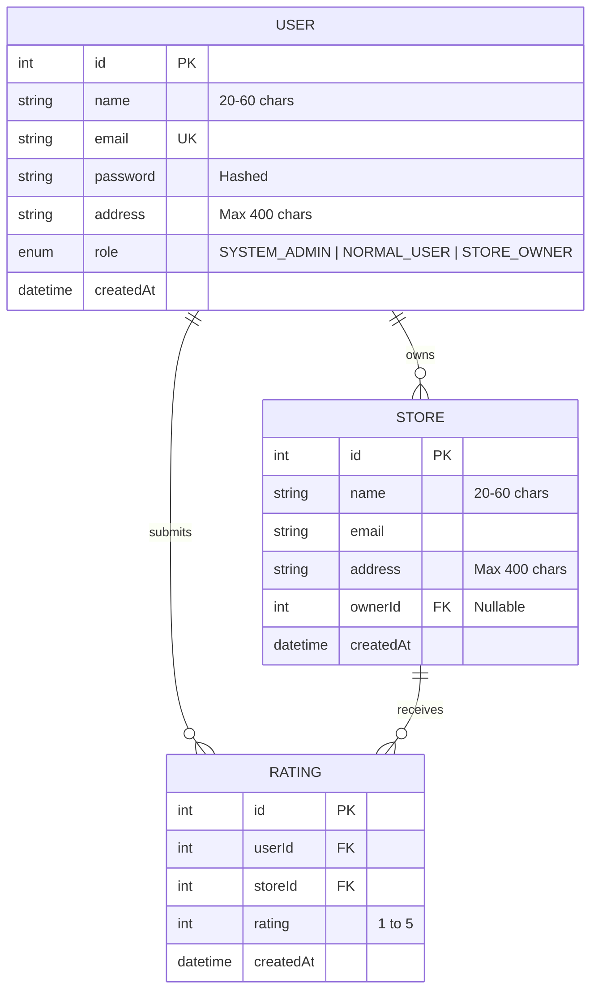

# 🏬 Store Rating Platform

> **Full Stack Developer Coding Challenge Submission** for **Roxiler Systems**.

A full-stack Web Application that enables users to register, browse stores, and submit/modify ratings (range 1 to 5). Features role-based access control (RBAC) with dedicated dashboards for **System Administrators**, **Store Owners**, and **Normal Users**.

---

## 🛠️ Tech Stack

- **Backend Framework**: Express.js (Node.js)
- **Database**: PostgreSQL / MySQL / SQLite (Configured with **Sequelize ORM**; defaults to zero-config SQLite for instant setup)
- **Frontend**: React.js (Vite) + Lucide Icons + Modern Glassmorphic CSS Design System
- **Authentication**: JWT (JSON Web Tokens) with `bcryptjs` password hashing
- **Validation**: Strict validation matching all PDF form rules
- **Containerization**: Docker & Docker Compose setup

---

## ✨ Key Features & Requirements Compliance

| User Role | Capabilities & Requirements | Implemented |
| :--- | :--- | :---: |
| **System Administrator** | • Add new stores, normal users, and admin users | ✅ |
| | • Dashboard displaying **Total Users**, **Total Stores**, **Total Submitted Ratings** | ✅ |
| | • Add users with Name, Email, Password, Address, Role | ✅ |
| | • View stores list with Name, Email, Address, Overall Rating | ✅ |
| | • View users list with Name, Email, Address, Role, and Store Rating (if Store Owner) | ✅ |
| | • Filter listings based on Name, Email, Address, and Role | ✅ |
| | • View complete profile details for any user in modal view | ✅ |
| | • Sort all tables (ascending / descending) on key columns | ✅ |
| **Normal User** | • Sign up & Log in | ✅ |
| | • Update password after logging in | ✅ |
| | • View list of all registered stores | ✅ |
| | • Search stores by Store Name and Address | ✅ |
| | • Store listing displays Name, Address, Overall Rating, User's Rating | ✅ |
| | • Submit rating (1 to 5 stars) or modify existing submitted rating | ✅ |
| | • Sort store listings on key fields | ✅ |
| **Store Owner** | • Log in & Update password | ✅ |
| | • Dashboard: View store average rating & total reviews count | ✅ |
| | • Dashboard: View list of users who submitted ratings for their store | ✅ |
| | • Sort ratings breakdown table by User Name, Email, Rating, Date | ✅ |

---

## 🔒 Form Validations Enforced

Both Frontend and Backend enforce the strict validation rules specified in the prompt:

- **Name**: Minimum 20 characters, Maximum 60 characters.
- **Address**: Maximum 400 characters.
- **Password**: 8–16 characters long; must contain at least **1 uppercase letter** (`A-Z`) and at least **1 special character** (`!@#$%^&*()_+-=[]{}|;:',.<>?/`).
- **Email**: Standard RFC email format validation.

---

## 🚀 Quick Start Guide

### Prerequisites
- [Node.js](https://nodejs.org/) (v18 or higher)
- [npm](https://www.npmjs.com/)

---

### Option 1: Running Locally (Recommended for Instant Evaluation)

#### 1. Setup & Start Backend Server
```bash
cd backend
npm install
npm run seed  # Automatically seeds database with test users & stores
npm run dev   # Starts server on http://localhost:5000
```

#### 2. Setup & Start Frontend Client
In a new terminal window:
```bash
cd frontend
npm install
npm run dev   # Starts Vite client on http://localhost:5173
```

Now open **[http://localhost:5173](http://localhost:5173)** in your browser!

---

### Option 2: Running with Docker Compose

To run PostgreSQL, Backend, and Frontend in Docker containers:
```bash
docker-compose up --build
```
- Frontend: `http://localhost:3000`
- Backend: `http://localhost:5000`
- PostgreSQL: `localhost:5432`

---

## 🔑 Demo Login Accounts

Pre-seeded accounts for testing each role out of the box:

| Role | Email | Password | Details |
| :--- | :--- | :--- | :--- |
| **System Administrator** | `admin@storeplatform.com` | `Admin@1234` | System Admin with full management permissions |
| **Store Owner** | `owner.sterling@techhub.com` | `Owner@1234` | Owner of *Apex Electronics Superstore* |
| **Store Owner** | `owner.vance@bookhaven.com` | `Owner@1234` | Owner of *The Classic Book Emporium* |
| **Normal User** | `johnathan.doe@example.com` | `User@12345` | Normal User who can browse & rate stores |

*Note: The login page includes quick-fill demo buttons for instant access to each role!*

---

## 📊 Database Schema (ERD)



---

## 📂 Project Structure

```
Roxiler_coding_challenge/
├── backend/
│   ├── src/
│   │   ├── config/
│   │   │   └── db.js            # Sequelize Database Config (Postgres/MySQL/SQLite)
│   │   ├── controllers/
│   │   │   ├── adminController.js
│   │   │   ├── authController.js
│   │   │   ├── ownerController.js
│   │   │   └── storeController.js
│   │   ├── middleware/
│   │   │   └── auth.js          # JWT & Role RBAC Middlewares
│   │   ├── models/
│   │   │   ├── User.js
│   │   │   ├── Store.js
│   │   │   ├── Rating.js
│   │   │   └── index.js
│   │   ├── routes/
│   │   ├── seeders/
│   │   │   └── seed.js          # Auto-seeder
│   │   ├── utils/
│   │   │   └── validators.js    # Strict validation rules
│   │   └── server.js
│   ├── .env
│   └── package.json
│
├── frontend/
│   ├── src/
│   │   ├── components/
│   │   │   ├── Navbar.jsx
│   │   │   ├── StarRating.jsx
│   │   │   ├── SortableTable.jsx
│   │   │   ├── Modal.jsx
│   │   │   ├── AddUserModal.jsx
│   │   │   ├── AddStoreModal.jsx
│   │   │   ├── UserDetailsModal.jsx
│   │   │   └── UpdatePasswordModal.jsx
│   │   ├── context/
│   │   │   └── AuthContext.jsx
│   │   ├── pages/
│   │   │   ├── LoginPage.jsx
│   │   │   ├── RegisterPage.jsx
│   │   │   ├── AdminDashboard.jsx
│   │   │   ├── UserDashboard.jsx
│   │   │   └── StoreOwnerDashboard.jsx
│   │   ├── services/
│   │   │   └── api.js
│   │   ├── index.css
│   │   ├── App.jsx
│   │   └── main.jsx
│   └── package.json
│
├── docker-compose.yml
└── README.md
```

---

## 📡 API Endpoints Reference

| Method | Endpoint | Access | Description |
| :--- | :--- | :--- | :--- |
| `POST` | `/api/auth/register` | Public | Register a new Normal User |
| `POST` | `/api/auth/login` | Public | Authenticate user & get JWT token |
| `POST` | `/api/auth/update-password` | Authenticated | Update user password |
| `GET` | `/api/auth/me` | Authenticated | Fetch current user profile |
| `GET` | `/api/admin/stats` | Admin | Dashboard metrics (Users, Stores, Ratings) |
| `POST` | `/api/admin/add-user` | Admin | Create Admin, User, or Store Owner |
| `POST` | `/api/admin/add-store` | Admin | Create a new store |
| `GET` | `/api/admin/users` | Admin | List users with search, role filter, sorting |
| `GET` | `/api/admin/stores` | Admin | List stores with overall rating & sorting |
| `GET` | `/api/admin/users/:id` | Admin | View user details & owner rating breakdown |
| `GET` | `/api/stores` | User / All | List stores with search (Name/Address) & user rating |
| `POST` | `/api/stores/rating` | Normal User | Submit or update store rating (1-5) |
| `GET` | `/api/owner/dashboard` | Store Owner | View store average rating & user reviews list |

---

## 📝 License

This project is created for the **Roxiler Systems FullStack Developer Coding Challenge**.
